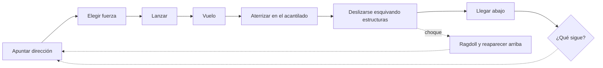

# Core Loop

## Por definir #pendiente
- Qué pasa al llegar abajo (puntaje, monedas, mejoras…)
- Cómo se cierra el ciclo y vuelve a empezar

Mecánicas: [[Resortera]] → [[Vuelo]] → [[Deslizamiento]] → [[Obstáculos]]
